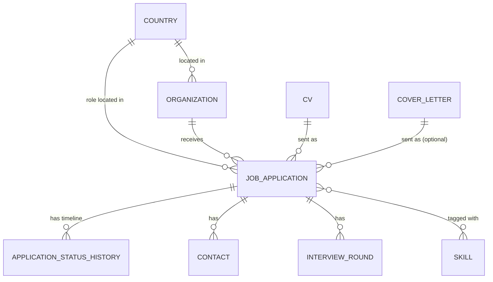

# Domain Model

## Entities

### Country
Seeded reference data. Every other entity that needs a location points at
a `Country` by id, never by free-text name.

- `id`
- `name`
- `iso_code` (e.g. `DE`, `RO`) — placeholder-accurate for now, to be
  corrected later without touching foreign keys
- `flag_emoji` or `flag_url` (placeholder for now)

### Organization
A company you've applied to. One organization can have **many** job
applications over time (e.g. three different roles at Siemens).

- `id`
- `name`
- `country_id` → Country (the organization's primary/HQ location)
- `website` (optional)
- `notes` (free text, optional)
- timestamps

### CV
A single uploaded CV file, versioned/labeled by you. CVs are a **reusable
library**: the same CV can be attached to many job applications, and a
single application always points at exactly one CV — whichever version was
actually sent.

- `id`
- `label` (e.g. "v3 - backend focus", "2026-01 general") — your own naming,
  not derived
- `file_path` (location on the local filesystem/volume)
- `original_filename`
- `uploaded_at`
- `notes` (optional)

### Skill
A tag describing a technology/competency, reusable across applications
(e.g. "React", "PostgreSQL", "Kotlin"). Lets you later ask "which CV did I
use for React roles?".

- `id`
- `name` (unique)

### CoverLetter
Mirrors `CV` exactly — a reusable, uploaded-once library entry. Cover
letters get tailored per application just as often as CVs do, so the same
"which version did I send them" problem applies. Unlike `CV`, attaching one
to a `JobApplication` is **optional** — not every application gets a cover
letter.

- `id`
- `label`
- `file_path`
- `original_filename`
- `uploaded_at`
- `notes` (optional)

### JobApplication
The central entity — one row per application you sent. Links an
Organization, the CV you actually sent, and the country where **that
specific role** is based (which may differ from the organization's own
country, e.g. a remote role or a foreign subsidiary).

- `id`
- `organization_id` → Organization
- `cv_id` → CV
- `cover_letter_id` → CoverLetter (optional)
- `country_id` → Country (role location, independent of the organization's country)
- `job_title`
- `job_posting_url` (optional)
- `source` (e.g. "LinkedIn", "Company site", "Referral", "Indeed" — free text or small enum)
- `applied_at` (date)
- `current_status` (denormalized convenience field — always equal to the
  latest entry in `ApplicationStatusHistory`, kept for cheap filtering/listing)
- `notes` (optional)
- timestamps

### ApplicationStatusHistory
An append-only timeline of status changes for a job application — this is
what answers "when did they call me, and what did I say happened next".

- `id`
- `job_application_id` → JobApplication
- `status` (e.g. `applied`, `screening`, `interview`, `offer`, `rejected`, `withdrawn`, `no_response`)
- `changed_at` (date/timestamp)
- `note` (optional free text — "recruiter called, phone screen scheduled")

### Contact
A recruiter or hiring contact associated with a job application.

- `id`
- `job_application_id` → JobApplication
- `name`
- `email` (optional)
- `phone` (optional)
- `role` (optional, e.g. "Recruiter", "Hiring Manager")

### InterviewRound
A structured step in an application's interview process — distinct from
`ApplicationStatusHistory`, which tracks the application's overall state.
A round records *what kind* of interview and *when*, so "I have a technical
round with Siemens next Tuesday" is a queryable fact, not buried in a note.

- `id`
- `job_application_id` → JobApplication
- `round_type` (e.g. "Phone screen", "Technical", "Onsite", "HR" — free text)
- `scheduled_at` (date/timestamp)
- `outcome` (`scheduled`, `passed`, `failed`, `cancelled` — default `scheduled`)
- `notes` (optional)

### JobApplicationSkill (join table)
Many-to-many between JobApplication and Skill — which skills/tags were
relevant to (or emphasized in) a given application.

- `job_application_id` → JobApplication
- `skill_id` → Skill

## Relationships

## Derived / computed fields (not stored)

Two of your requested features — follow-up reminders and "have I been
ghosted" — don't need new tables or a manual status. They're both the same
computation at different thresholds, derived at read time from
`applied_at` and the latest `ApplicationStatusHistory.changed_at`:

- `daysSinceLastUpdate` = now − `changed_at` of the most recent status
  history row (or `applied_at` if none exists beyond the initial one).
- `needsFollowUp` = true when `current_status` is non-terminal (not
  `rejected`, `offer`, `withdrawn`, or `no_response`) **and**
  `daysSinceLastUpdate` ≥ a follow-up threshold (suggested default: 14 days).
- `isGhosted` = same condition, but at a longer threshold (suggested
  default: 30 days) — a stronger signal meaning "realistically, this one's
  dead." It's a suggestion surfaced to you, not an automatic status change;
  you still decide whether to manually log a `no_response` status once you
  agree with it.

Thresholds are configuration, not schema — they can be constants for now
and become user-adjustable later without any migration.

## Business rules

1. A `JobApplication` always has exactly one `CV`, one `Organization`, and
   one `Country` (the role's location). All three are required. A
   `CoverLetter` is optional — not every application gets one.
2. A `CV` (and, likewise, a `CoverLetter`) can be reused by any number of
   `JobApplication` rows. Deleting a CV or cover letter that is still
   referenced by an application should be prevented (or the application
   should be required to point elsewhere first) — no orphaned references.
3. `ApplicationStatusHistory` is append-only. To change an application's
   status you insert a new history row; you don't edit old ones. The most
   recent row (by `changed_at`, tie-broken by `id`) determines
   `JobApplication.current_status`.
4. Every new `JobApplication` implicitly gets an initial status history
   entry (`applied`, dated `applied_at`) at creation time.
5. `Country` rows are never deleted once referenced — they are reference
   data. Corrections (accurate names/flags) happen as updates in place, so
   `country_id` values on existing organizations/applications remain valid.
6. `Skill` names are unique; tagging an application with a skill that
   doesn't exist yet creates it (or the UI offers autocomplete over
   existing ones — implementation detail, not a schema constraint).
7. One organization legitimately has many job applications — this is not
   an edge case, it's the normal case the tool is built around.
8. `InterviewRound` rows belong to exactly one `JobApplication` and are
   deleted along with it. A round's `outcome` is independent of the
   application's `current_status` — passing a technical round doesn't by
   itself change the application's status; you still log that via
   `ApplicationStatusHistory` (e.g. moving to `interview` or `offer`).
