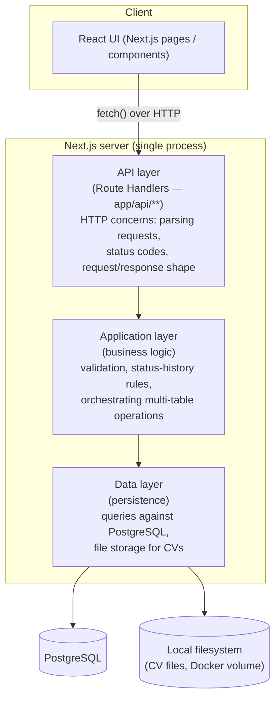

# Architecture

## How Next.js fits together

Yes — Next.js can serve both the UI and the backend from a single project.
Since this is your first project on it, here's the shape in plain terms:

- **Pages/UI** live under `app/` as React components (Server and Client
  Components). This is what renders in the browser.
- **HTTP API endpoints** live alongside them as *Route Handlers* — files
  named `route.ts` under `app/api/**`. Each one exports functions named
  after HTTP verbs (`GET`, `POST`, `PATCH`, `DELETE`) and Next.js wires them
  up to a URL automatically based on the folder path (e.g.
  `app/api/organizations/route.ts` → `GET/POST /api/organizations`).
- These route handlers are plain HTTP endpoints — the same request/response
  model as any other backend framework. The React UI calls them with
  `fetch`, the same way it would call any REST API.

So: **one project, one dev server, one Docker image**, but two things
running inside it — pages and an HTTP API — because Next.js is designed to
be both a frontend and a backend framework at once.

This document intentionally stops at that level of detail. Exact folder
conventions, which parts are Server Components vs. Client Components, the
ORM/query layer, and validation library are **implementation-phase
decisions** — not fixed here, since the goal right now is agreeing on the
domain and the API surface, not on Next.js internals.

## Logical layers

Regardless of exact file layout, the server side of the app is expected to
separate into three logical layers. This is a conceptual model to design
against — not a mandate on folder names.

- **API layer** — thin. Receives HTTP requests, validates shape, calls into
  the application layer, maps results to HTTP responses. No business rules
  live here.
- **Application layer** — where domain rules from
  [01-domain-model.md](./01-domain-model.md) live: e.g. "creating a job
  application also creates its first status-history row", "a CV can't be
  deleted while referenced". This layer is framework-agnostic in spirit,
  even if it happens to be TypeScript functions called directly by route
  handlers (no network hop needed — it's the same process).
- **Data layer** — the only layer that talks to PostgreSQL or the
  filesystem. Everything above it works with domain objects, not SQL rows
  or file paths directly.

This layering exists so that business rules (layer 2) aren't duplicated
across every route handler, and so persistence details (layer 3) can change
later (e.g. swapping raw SQL for an ORM) without touching the other two.

## File storage for CVs

Uploaded CV files are **not** stored in PostgreSQL as blobs. They're written
to a local directory (mounted as a Docker volume — see
[05-deployment.md](./05-deployment.md)), and the `cvs` table stores only the
`file_path` pointing at them. This keeps the database small and lets CV
files be inspected/backed up directly on disk.

## Open questions for the implementation phase

These are deliberately **not** decided yet:

- ORM/query builder vs. raw SQL (Prisma, Drizzle, `pg` directly, etc.)
- Server Components vs. Client Components split in the UI
- Validation library for request payloads (e.g. Zod)
- Exact `app/` folder structure beyond the `api/` convention described above
- Migration tooling for the PostgreSQL schema
