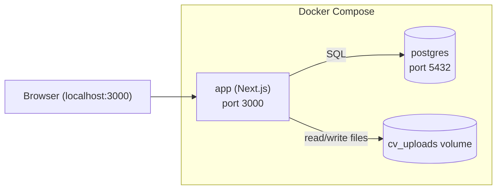

# Deployment

Local-only, single-user, Docker-based. No cloud provider, no CI/CD
requirement, no TLS/auth needed.

## Shape

`docker-compose` with two services:



- **`app`** — the Next.js application (UI + API routes in one container),
  built from a `Dockerfile` in the repo root, exposed on `localhost:3000`.
- **`db`** — official `postgres` image, with a named volume for data
  persistence across container restarts (`pg_data`).
- **`cv_uploads`** — a separate named volume mounted into `app`, holding
  the uploaded CV files referenced by `cvs.file_path`.

## Illustrative `docker-compose.yml` shape

```yaml
services:
  db:
    image: postgres:16
    environment:
      POSTGRES_DB: cvtracker
      POSTGRES_USER: cvtracker
      POSTGRES_PASSWORD: cvtracker   # local-only, no secrets management needed
    ports:
      - "5432:5432"
    volumes:
      - pg_data:/var/lib/postgresql/data
      - ./db/seed:/docker-entrypoint-initdb.d  # runs schema + country seed on first boot

  app:
    build: .
    ports:
      - "3000:3000"
    environment:
      DATABASE_URL: postgresql://cvtracker:cvtracker@db:5432/cvtracker
      CV_STORAGE_PATH: /data/cvs
    depends_on:
      - db
    volumes:
      - cv_uploads:/data/cvs

volumes:
  pg_data:
  cv_uploads:
```

Exact env var names, whether schema setup happens via
`docker-entrypoint-initdb.d` SQL scripts or an ORM migration step run on
container start, and the `Dockerfile` contents are implementation-phase
details — the above is the shape, not the final file.

## Local workflow

1. `docker compose up` — starts Postgres (seeded with schema + countries on
   first run) and the Next.js app together.
2. App available at `http://localhost:3000`.
3. Uploaded CVs persist in the `cv_uploads` volume; database persists in
   `pg_data`. Both survive `docker compose down` (without `-v`).
4. `docker compose down -v` for a full reset (wipes DB + uploaded CVs) —
   useful during early development.

## Explicitly out of scope

- Remote hosting, domains, TLS.
- Backups/disaster recovery beyond "the Docker volumes are on your disk".
- Multi-user concerns, secrets management, environment-specific configs
  (staging/prod) — there is only one environment: your machine.
