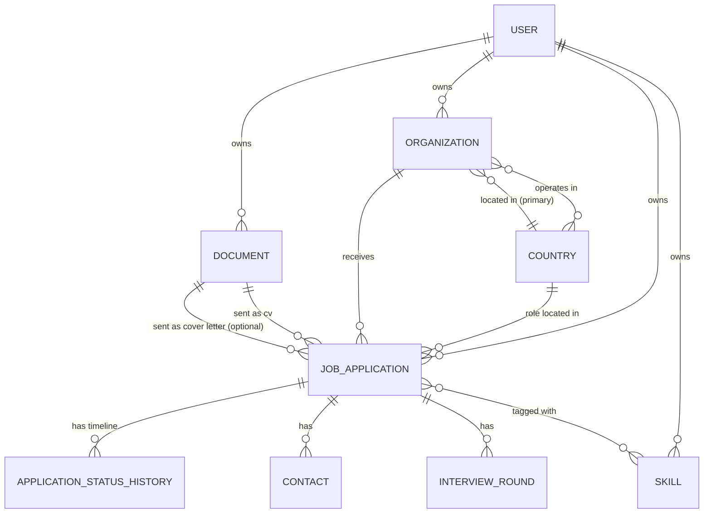

# Domain Model

## Entities

### User
The owner of a set of data, created via signup. Kept deliberately minimal —
no profile image, no roles/permissions.

- `id`
- `name`
- `email` (unique)
- `password_hash` (hashed at signup time — bcrypt/argon2; never plaintext,
  never returned by any endpoint)
- `created_at`

There is no seeded user — the first account, like every account, is created
by calling signup. See [04-api-design.md](./04-api-design.md#authentication)
for the signup/login/session flow.

### Country
Seeded reference data. Every other entity that needs a location points at
a `Country` by id, never by free-text name.

- `id`
- `name`
- `iso_code` (e.g. `DE`, `RO`) — placeholder-accurate for now, to be
  corrected later without touching foreign keys
- `flag_emoji` or `flag_url` (placeholder for now)

### Organization
A company you've applied to. One organization can have **many** job
applications over time (e.g. three different roles at Siemens). Owned by a
`User` — each user has their own list of organizations.

- `id`
- `user_id` → User
- `name`
- `country_id` → Country (the organization's primary/HQ location)
- `website` (optional)
- `notes` (free text, optional)
- timestamps

An organization can operate in more than one country (branches, regional
offices), so a single `country_id` isn't enough to capture where you might
actually be applying. See `OrganizationCountry` below for the broader
set, which the UI uses to filter the country choices when logging a new
job application for this organization.

### OrganizationCountry (join table)
The set of countries an organization is known to operate in — a superset
that should typically include the organization's primary `country_id`,
though this isn't database-enforced. Maintained as part of the
organization itself: there's no separate add/remove endpoint for this —
creating or updating an `Organization` replaces its full set of countries
in one write (see
[04-api-design.md](./04-api-design.md#organizations)). It exists purely to
narrow the country dropdown when creating a `JobApplication` for this
organization; it does **not** restrict which country a job application can
actually use (see business rule 12).

- `organization_id` → Organization
- `country_id` → Country

### Document
A single uploaded file — either a CV or a cover letter — versioned/labeled
by you. Documents are a **reusable library** displayed together in one grid
in the UI, distinguished by `document_type`: the same document can be
attached to many job applications, and a single application points at
exactly one CV-type document (required) and optionally one cover-letter-type
document — whichever versions were actually sent.

- `id`
- `user_id` → User (each user has their own document library)
- `document_type` (`cv` | `cover_letter`)
- `label` (e.g. "v3 - backend focus", "2026-01 general") — your own naming,
  not derived
- `file_path` (location on the local filesystem/volume)
- `original_filename`
- `uploaded_at`
- `notes` (optional)

CV and cover letter started as identical, separately-modeled entities; they
were merged into one `Document` entity specifically because the UI shows
both in a single grid — one library, one upload flow, one endpoint, filtered
by type rather than assembled client-side from two lists. The tradeoff: the
database can no longer guarantee by itself that a `JobApplication`'s CV slot
holds a `cv`-type document rather than a `cover_letter`-type one — that
check moves to the application layer (see business rule 1a).

### Skill
A tag describing a technology/competency, reusable across applications
(e.g. "React", "PostgreSQL", "Kotlin"). Lets you later ask "which CV did I
use for React roles?". Scoped per user — each user builds their own tag
vocabulary; uniqueness is per-user, not global.

- `id`
- `user_id` → User
- `name` (unique per user)

### JobApplication
The central entity — one row per application you sent. Links an
Organization, the CV document you actually sent, and the country where
**that specific role** is based (which may differ from the organization's
own country, e.g. a remote role or a foreign subsidiary). Owned by a `User`.

- `id`
- `user_id` → User
- `organization_id` → Organization
- `cv_document_id` → Document (must be a `cv`-type document)
- `cover_letter_document_id` → Document, optional (must be a `cover_letter`-type document)
- `country_id` → Country (role location, independent of the organization's country)
- `job_title`
- `job_posting_url` (optional)
- `source` (e.g. "LinkedIn", "Company site", "Referral", "Indeed" — free text or small enum)
- `applied_at` (date)
- `current_status` (denormalized convenience field — always equal to the
  latest entry in `ApplicationStatusHistory`, kept for cheap filtering/listing)
- `notes` (optional)
- timestamps

### ApplicationStatusHistory
An append-only timeline of status changes for a job application — this is
what answers "when did they call me, and what did I say happened next".

- `id`
- `job_application_id` → JobApplication
- `status` (e.g. `applied`, `screening`, `interview`, `offer`, `rejected`, `withdrawn`, `no_response`)
- `changed_at` (date/timestamp)
- `note` (optional free text — "recruiter called, phone screen scheduled")

### Contact
A recruiter or hiring contact associated with a job application.

- `id`
- `job_application_id` → JobApplication
- `name`
- `email` (optional)
- `phone` (optional)
- `role` (optional, e.g. "Recruiter", "Hiring Manager")

### InterviewRound
A structured step in an application's interview process — distinct from
`ApplicationStatusHistory`, which tracks the application's overall state.
A round records *what kind* of interview and *when*, so "I have a technical
round with Siemens next Tuesday" is a queryable fact, not buried in a note.

- `id`
- `job_application_id` → JobApplication
- `round_type` (e.g. "Phone screen", "Technical", "Onsite", "HR" — free text)
- `scheduled_at` (date/timestamp)
- `outcome` (`scheduled`, `passed`, `failed`, `cancelled` — default `scheduled`)
- `notes` (optional)

### JobApplicationHasSkill (join table)
Many-to-many between JobApplication and Skill — which skills/tags were
relevant to (or emphasized in) a given application. Unlike
`OrganizationCountry`, this one *is* managed through its own
sub-resource endpoints (see
[04-api-design.md](./04-api-design.md#skill-tags-sub-resource)) — tags are
added/removed incrementally over an application's life as you decide which
skills to emphasize, rather than being set once at creation.

- `job_application_id` → JobApplication
- `skill_id` → Skill

## Relationships

`Country` is the one entity that stays global, shared reference data — it
is not owned by any `User`. `ApplicationStatusHistory`, `Contact`,
`InterviewRound`, `OrganizationCountry`, and `JobApplicationHasSkill`
don't need their own `user_id`: they're only ever reached through their
parent (`JobApplication` or `Organization`), which is already scoped.

## Derived / computed fields (not stored)

Two of your requested features — follow-up reminders and "have I been
ghosted" — don't need new tables or a manual status. They're both the same
computation at different thresholds, derived at read time from
`applied_at` and the latest `ApplicationStatusHistory.changed_at`:

- `daysSinceLastUpdate` = now − `changed_at` of the most recent status
  history row (or `applied_at` if none exists beyond the initial one).
- `needsFollowUp` = true when `current_status` is non-terminal (not
  `rejected`, `offer`, `withdrawn`, or `no_response`) **and**
  `daysSinceLastUpdate` ≥ a follow-up threshold (suggested default: 14 days).
- `isGhosted` = same condition, but at a longer threshold (suggested
  default: 30 days) — a stronger signal meaning "realistically, this one's
  dead." It's a suggestion surfaced to you, not an automatic status change;
  you still decide whether to manually log a `no_response` status once you
  agree with it.

Thresholds are configuration, not schema — they can be constants for now
and become user-adjustable later without any migration.

## Business rules

1. A `JobApplication` always has exactly one CV `Document`, one
   `Organization`, and one `Country` (the role's location). All three are
   required. A cover-letter `Document` is optional — not every application
   gets one.
   1a. The application layer must enforce that `cv_document_id` references
       a `Document` with `document_type = 'cv'`, and
       `cover_letter_document_id` (when set) references one with
       `document_type = 'cover_letter'`. The database does not enforce this
       distinction — it's the accepted tradeoff of merging CV and cover
       letter into one `Document` entity for a unified UI grid.
2. A `Document` can be reused by any number of `JobApplication` rows (as
   either its CV or cover letter, per its type). Deleting a document that is
   still referenced by an application should be prevented (or the
   application should be required to point elsewhere first) — no orphaned
   references.
3. `ApplicationStatusHistory` is append-only. To change an application's
   status you insert a new history row; you don't edit old ones. The most
   recent row (by `changed_at`, tie-broken by `id`) determines
   `JobApplication.current_status`.
4. Every new `JobApplication` implicitly gets an initial status history
   entry (`applied`, dated `applied_at`) at creation time.
5. `Country` rows are never deleted once referenced — they are reference
   data. Corrections (accurate names/flags) happen as updates in place, so
   `country_id` values on existing organizations/applications remain valid.
6. `Skill` names are unique; tagging an application with a skill that
   doesn't exist yet creates it (or the UI offers autocomplete over
   existing ones — implementation detail, not a schema constraint).
7. One organization legitimately has many job applications — this is not
   an edge case, it's the normal case the tool is built around.
8. `InterviewRound` rows belong to exactly one `JobApplication` and are
   deleted along with it. A round's `outcome` is independent of the
   application's `current_status` — passing a technical round doesn't by
   itself change the application's status; you still log that via
   `ApplicationStatusHistory` (e.g. moving to `interview` or `offer`).
9. Every `Organization`, `Document`, `Skill`, and `JobApplication` belongs
   to exactly one `User`. All queries and writes in the application/API
   layers must filter/scope by the current user's `user_id` — there is no
   cross-user visibility.
10. `Skill.name` uniqueness is scoped to `(user_id, name)`, not global —
    each user can have their own "React" skill row, independent of any
    other user's.
11. `User` accounts are created only via signup — there is no seed data for
    the `user` table (unlike `Country`). The current user for any request is
    resolved from a signed JWT (see
    [04-api-design.md](./04-api-design.md#authentication)), never passed
    directly by the client and never trusted from anywhere but that
    verified token.
12. `OrganizationCountry` is advisory, not a constraint: a
    `JobApplication.country_id` may be **any** `Country`, including one not
    in its organization's `OrganizationCountry` set (e.g. the very
    first time you apply to a new branch). The set only drives UI filtering
    — it is never checked or enforced when a `JobApplication` is created or
    updated.
13. `OrganizationCountry` has full-replace semantics: creating or
    updating an `Organization` with a list of country ids sets its complete
    set of operating countries, replacing whatever was there before — there
    is no incremental add/remove operation for it (contrast with
    `JobApplicationHasSkill`, rule per its own section, which is managed
    incrementally through dedicated endpoints).
