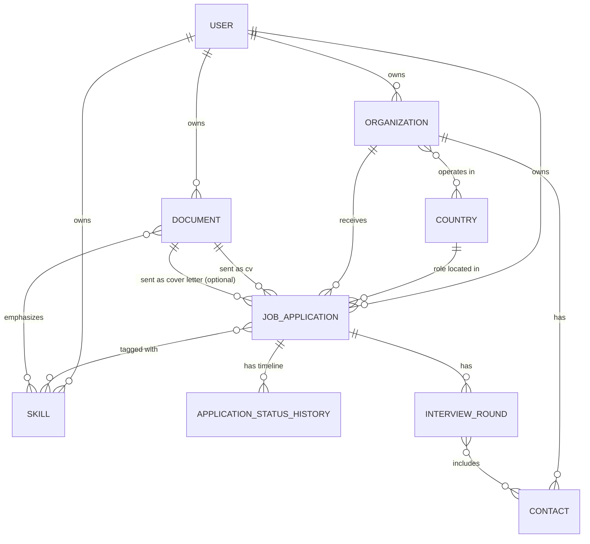

# Domain Model

## Entities

### User
The owner of a set of data, created via signup. Kept deliberately minimal —
no profile image, no roles/permissions.

- `id`
- `email` (unique)
- `name`
- `password_hash` (hashed at signup time — bcrypt/argon2; never plaintext,
  never returned by any query)
- `created_at`, `updated_at`

There is no seeded user in the required setup — the first account, like every
account, is created by calling signup. The optional sample data
(`npm run db:seed:sample`) adds one example user for development. See [04-data-access.md](./04-data-access.md#authentication)
for the signup/sign-in/session flow.

### Country
Seeded reference data. Every other entity that needs a location points at
a `Country` by id, never by free-text name.

- `id`
- `iso_code` (e.g. `DE`, `RO`), unique — placeholder-accurate for now, to be
  corrected later without touching foreign keys
- `name`

No flag column: the UI renders each country's flag from `iso_code` via
[flag-icons](https://flagicons.lipis.dev/) (bundled SVGs, works offline) —
nothing to store or keep in sync.

### Organization
An organization you've applied to. One organization can have **many** job
applications over time (e.g. three different roles at Siemens). Owned by a
`User` — each user has their own list of organizations.

- `id`
- `name`
- `notes` (free text, optional)
- `websiteUrl` (optional)
- `user_id` → User
- timestamps

An organization can operate in more than one country (branches, regional
offices), so there's no single primary/HQ `country_id` field here — see
`OrganizationCountry` below for the full set, which the UI uses to filter
the country choices when logging a new job application for this
organization.

### OrganizationCountry (join table)
The set of countries an organization is known to operate in. Maintained as
part of the organization itself: there's no separate add/remove action
for this —
creating or updating an `Organization` replaces its full set of countries
in one write (see
[04-data-access.md](./04-data-access.md#actions)). It exists purely to
narrow the country dropdown when creating a `JobApplication` for this
organization; it does **not** restrict which country a job application can
actually use (see business rule 12).

- `organization_id` → Organization
- `country_id` → Country

### Document
A single uploaded file — either a CV or a cover letter — versioned/named
by you. Documents are a **reusable library** displayed together in one grid
in the UI, distinguished by `type`: the same document can be
attached to many job applications, and a single application points at
exactly one CV-type document (required) and optionally one cover-letter-type
document — whichever versions were actually sent.

- `id`
- `type` (`cv` | `cover_letter`)
- `name` (e.g. "v3 - backend focus", "2026-01 general") — your own naming,
  not derived
- `file_path` (location on the local filesystem/volume)
- `original_filename`
- `size` (file size in bytes)
- `notes` (optional)
- `user_id` → User (each user has their own document library)
- `uploaded_at`
- skills — the skills this document emphasizes (see `DocumentHasSkill`)

CV and cover letter started as identical, separately-modeled entities; they
were merged into one `Document` entity specifically because the UI shows
both in a single grid — one library, one upload flow, one set of actions, filtered
by type rather than assembled client-side from two lists. The tradeoff: the
database can no longer guarantee by itself that a `JobApplication`'s CV slot
holds a `cv`-type document rather than a `cover_letter`-type one — that
check moves to the application layer (see business rule 1a).

### Skill
A tag describing a technology/competency, reusable across applications
(e.g. "React", "PostgreSQL", "Kotlin"). Lets you later ask "which CV did I
use for React roles?". Scoped per user — each user builds their own tag
vocabulary; uniqueness is per-user, not global.

- `id`
- `name` (unique per user)
- `user_id` → User

### JobApplication
The central entity — one row per application you sent. Links an
Organization, the CV document you actually sent, and the country where
**that specific role** is based (which may differ from the organization's
own country, e.g. a remote role or a foreign subsidiary). Owned by a `User`.

- `id`
- `title`
- `posting_url` (optional)
- `source` (e.g. "LinkedIn", "Company site", "Referral", "Indeed" — free text or small enum)
- `current_status` (denormalized convenience field — always equal to the
  latest entry in `ApplicationStatusHistory`, kept for cheap filtering/listing)
- `applied_at` (date)
- `notes` (optional)
- `organization_id` → Organization
- `cv_document_id` → Document (must be a `cv`-type document)
- `cover_letter_document_id` → Document, optional (must be a `cover_letter`-type document)
- `country_id` → Country (role location, independent of the organization's country)
- `user_id` → User
- timestamps

### ApplicationStatusHistory
An append-only timeline of status changes for a job application — this is
what answers "when did they call me, and what did I say happened next".

- `id`
- `status` (`applied`, `screening`, `interview`, `offer`, `rejected`, `withdrawn`, `no_response`, which is the status called **Ghosted**)
- `note` (optional free text — "recruiter called, phone screen scheduled")
- `job_application_id` → JobApplication
- `changed_at` (date/timestamp)

### Contact
A person at an organization — a recruiter, a hiring manager, an engineer you
interviewed with. A contact belongs to the organization, not to one application, so
the same person is one record across every application at that organization. Which
applications and InterviewRounds they were part of is recorded by the InterviewRounds
(`InterviewRoundHasContact`).

- `id`
- `name`
- `email` (optional)
- `phone` (optional)
- `role` (optional, e.g. "Recruiter", "Hiring Manager")
- `organization_id` → Organization

### InterviewRound
A structured step in an application's interview process — distinct from
`ApplicationStatusHistory`, which tracks the application's overall state.
An InterviewRound records *what kind* of interview and *when*, so "I have a technical
InterviewRound with Siemens next Tuesday" is a queryable fact, not buried in a note.

- `id`
- `round_type` (`intro_call`, `technical`, `coding`, `take_home`, `behavioral`). It
  says what the InterviewRound is about.
- `scheduled_at` (date/timestamp)
- `outcome` (`scheduled`, `passed`, `failed`, `cancelled` — default `scheduled`)
- `notes` (optional)
- `job_application_id` → JobApplication
- contacts → Contact, many-to-many through `InterviewRoundHasContact` — who is in
  the InterviewRound (a recruiter and a technical interviewer, two engineers, ...).
  Deleting a contact only removes it from the InterviewRounds; the InterviewRounds stay.

### InterviewRoundHasContact (join table)
- `interview_round_id` → InterviewRound
- `contact_id` → Contact
- composite primary key (`interview_round_id`, `contact_id`)

### JobApplicationHasSkill (join table)
Many-to-many between JobApplication and Skill — which skills/tags were
relevant to (or emphasized in) a given application. Like
`OrganizationCountry` and `DocumentHasSkill`, it has no actions of its
own: the set of skills is written in one go when the application is created.
Replacing the full set when it is updated is intended but not implemented yet
(see [04-data-access.md](./04-data-access.md#limitations)).

When an application is created, the skills of the selected CV (and cover
letter, if any) are **copied** into the form as a pre-fill; the user can
edit them before saving. The application's tags are its own record — later
changes to a document's skills never alter existing applications.

- `job_application_id` → JobApplication
- `skill_id` → Skill

### DocumentHasSkill (join table)
Many-to-many between Document and Skill — which skills a CV or cover letter
emphasizes. Used to pre-fill an application's skills when the document is
selected. Set as part of creating the document, not through its own actions.
Replacing the full set when the document is updated is intended but not
implemented yet.

- `document_id` → Document
- `skill_id` → Skill

## Relationships

`Country` is the one entity that stays global, shared reference data — it
is not owned by any `User` (see business rule 9: every `Organization`,
`Document`, `Skill`, and `JobApplication` — unlike `Country` — belongs to
exactly one `User` and must be scoped by `user_id` in every query).
`ApplicationStatusHistory`, `Contact`,
`InterviewRound`, `InterviewRoundHasContact`, `OrganizationCountry`,
`JobApplicationHasSkill`, and `DocumentHasSkill` don't need their own `user_id`: they're only ever reached
through their parent (`JobApplication`, `Organization` or `Document`), which
is already scoped. A `Contact` is reached through its `Organization`.

## Ghosted applications (derived, then recorded)

**Ghosted** is a status (stored as `no_response`). Setting it by hand and having
it set by the bulk action below produce exactly the same thing.

**Stale** is not a status or a stored flag: it is the computed condition that
makes an application *eligible* to be marked as Ghosted. An application is
stale when it is in progress (`applied`, `screening` or `interview`) and
nothing has happened to it for `GHOSTED_AFTER_MONTHS` (3 months, a constant in
`job-application-statuses.ts`): its `applied_at` and the latest
`ApplicationStatusHistory.changed_at` are both older than the cutoff. The list
is computed at read time (`getStaleJobApplications`).

Being stale is a suggestion surfaced to the user, not an automatic status
change. The user can accept it in bulk with `markGhostedJobApplications`, which
moves every stale application to Ghosted, writes a history row, and cancels
the InterviewRounds still to come. That action can be undone right after,
which also restores the InterviewRounds it cancelled.

There is no separate "needs follow-up" threshold, and no `daysSinceLastUpdate`
field; earlier drafts of this document proposed both.

## Business rules

1. A `JobApplication` always has exactly one CV `Document`, one
   `Organization`, and one `Country` (the role's location). All three are
   required. A cover-letter `Document` is optional — not every application
   gets one.
   1a. The application layer must enforce that `cv_document_id` references
       a `Document` with `type = 'cv'`, and
       `cover_letter_document_id` (when set) references one with
       `type = 'cover_letter'`. The database does not enforce this
       distinction — it's the accepted tradeoff of merging CV and cover
       letter into one `Document` entity for a unified UI grid.
2. A `Document` can be reused by any number of `JobApplication` rows (as
   either its CV or cover letter, per its type). Deleting a document that is
   still referenced by an application should be prevented (or the
   application should be required to point elsewhere first) — no orphaned
   references.
3. `ApplicationStatusHistory` is append-only. To change an application's
   status you insert a new history row; you don't edit old ones. The most
   recent row (by `changed_at`, tie-broken by `id`) determines
   `JobApplication.current_status`.
4. Every new `JobApplication` implicitly gets an initial status history
   entry (`applied`, dated `applied_at`) at creation time.
5. `Country` rows are never deleted once referenced — they are reference
   data. Corrections (accurate names/flags) happen as updates in place, so
   `country_id` values on existing job applications and `OrganizationCountry`
   rows remain valid.
6. `Skill` names are unique per user. Nothing in the app creates skills yet
   (see [04-data-access.md](./04-data-access.md#limitations)): the intent is
   that tagging with a skill that doesn't exist yet creates it, or the UI
   offers autocomplete over existing ones.
7. One organization legitimately has many job applications — this is not
   an edge case, it's the normal case the tool is built around.
8. `InterviewRound` rows belong to exactly one `JobApplication` and are
   deleted along with it. An InterviewRound can have several `Contact`s of that
   application's organization (and a new one can be created together with it,
   on that organization); one contact can be in several InterviewRounds,
   across applications.

   An InterviewRound's `outcome` and the application's `current_status` are
   **not** independent. They affect each other in the cases below, each in
   one transaction, with a status-history row wherever the status changes.
   An InterviewRound is *upcoming* when its outcome is `scheduled` and its
   date is in the future.

   - **Scheduling** an InterviewRound moves an application that is `applied`
     or `screening` to `interview`. In any other status (including
     `interview` itself, `offer`, `rejected`, `withdrawn` and `no_response`)
     the status is left alone.
   - **Setting an outcome** of `failed` on an application still in progress
     (`applied`, `screening` or `interview`) moves it to `rejected`, with a
     history note naming the InterviewRound's type — unless another
     InterviewRound is still upcoming. Then the status is left alone and the
     user is asked whether to reject. The outcomes `passed`, `scheduled` and
     `cancelled` never change the status, and a `failed` outcome never changes
     an application that is not in progress.
   - **Moving the application to a status** settles its InterviewRounds:
     `rejected` marks the earliest InterviewRound still `scheduled` as
     `failed` (unless one already failed, since that is what the rejection
     was about) and cancels the upcoming ones; `offer` marks the earliest
     InterviewRound still `scheduled` as `passed` and leaves the others;
     `withdrawn` and Ghosted cancel the upcoming ones. InterviewRounds in the
     past that are still `scheduled` are never cancelled automatically: only
     the user knows how they went. Moving the status back does not restore
     cancelled InterviewRounds, except through the undo of the bulk
     Ghosted action.
9. Every `Organization`, `Document`, `Skill`, and `JobApplication` belongs
   to exactly one `User`. Queries filter by the current user's `user_id`, so
   there is no cross-user visibility when reading. Writes, and foreign ids
   supplied by the client, are not checked: authorization is out of scope
   (see [04-data-access.md](./04-data-access.md#known-gaps)).
10. `Skill.name` uniqueness is scoped to `(user_id, name)`, not global —
    each user can have their own "React" skill row, independent of any
    other user's.
11. `User` accounts are created only via signup — the required seed data has
    nothing for the `user` table (unlike `Country`); only the optional sample
    data adds an example user. The current user for any request is
    resolved from a signed JWT (see
    [04-data-access.md](./04-data-access.md#authentication)), never passed
    directly by the client and never trusted from anywhere but that
    verified token.
12. `OrganizationCountry` is advisory, not a constraint: a
    `JobApplication.country_id` may be **any** `Country`, including one not
    in its organization's `OrganizationCountry` set (e.g. the very
    first time you apply to a new branch). The set only drives UI filtering
    — it is never checked or enforced when a `JobApplication` is created or
    updated.
13. `OrganizationCountry` has full-replace semantics: creating or
    updating an `Organization` with a list of country ids sets its complete
    set of operating countries, replacing whatever was there before — there
    is no incremental add/remove operation for it (`JobApplicationHasSkill` and
    `DocumentHasSkill` are meant to follow the same rule, with the full
    `skillIds` set sent on every write, but today it is only accepted when
    creating: the update actions don't take it).
