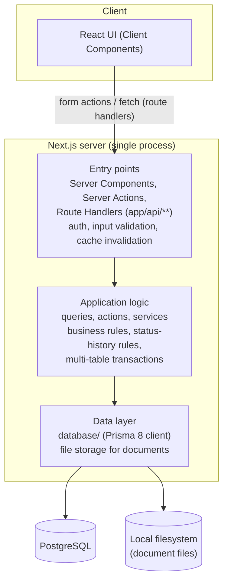

# Architecture

## How Next.js fits together

Next.js serves both the UI and the backend from one project: **one project,
one dev server, one Docker image**. There is no separate REST API; the UI
reaches the server through three mechanisms (details and the full list in
[04-data-access.md](./04-data-access.md)):

- **Server Components** render pages under `src/app/` and call **queries**
  (`src/features/<feature>/queries/`) directly, in the same process. No network
  hop, no `fetch`.
- **Server Actions** (`'use server'`, `src/features/<feature>/actions/`) are
  how every write happens. Forms post to them via `<form action={...}>` /
  `useActionState`; Next.js turns each into a POST under the hood.
- **Route Handlers** (`src/app/api/**/route.ts`) exist only for what the two
  above can't do: fetches the browser makes by itself (infinite scroll,
  dropdown search, via TanStack Query), file responses (document download,
  CSV/Excel export), and clearing the session cookie.

Code is organized by feature (`src/features/` has `auth`, `countries`,
`dashboard`, `documents`, `job-applications` and `organizations`), each with
its own `queries/`, `actions/`, `schemas/` (zod), `types/`, `constants/`,
`services/`, `hooks/` and `components/` as needed. Shared code is in `src/lib/`, shared
types in `src/types/`, shared UI in `src/components/`, and everything
database-related (Prisma contract, migrations, seeds, query helpers) in
`database/`. Shared code does not depend on a feature, with one exception:
`src/components/layout/` is the app shell (sidebar, top bar, user menu), which
puts the features together, so it imports their count queries, the sign-out
action and the create and export controls.

## Logical layers

The server side separates into three layers. Because queries and actions are
plain functions called in-process, the first one is not an HTTP layer:



- **Entry points** — thin. A Server Component awaits a query; a Server Action
  or Route Handler calls `verifySession()`, validates input with zod, calls
  into the logic, and returns a result (or, for route handlers, an HTTP
  response). No business rules here.
- **Application logic** — where the domain rules from
  [01-domain-model.md](./01-domain-model.md) live, e.g. "creating a job
  application also creates its first status-history row", "scheduling an
  interview moves an application to `interview`", "a failed InterviewRound rejects an
  application when none is left to come". Queries and actions hold this; reusable pieces go to a
  feature's `services/`, or a module named for the rule it keeps: `job-applications/lifecycle/` (status, status history and round outcomes) and `documents/stored-files/` (the files of the documents).
- **Data layer** — the Prisma client (`database/db.ts`) and the filesystem.
  Everything above works with typed models, not SQL or file paths directly
  (document files go through `documents/stored-files/`, behind a file adapter).

This layering keeps business rules out of components and route handlers, and
lets persistence details change without touching the other layers.

## Authentication flow

Signup and sign-in are Server Actions (`src/features/auth/*/actions/`), not
Route Handlers — the app calls into the server the same way for auth as for
everything else, via `<form action={...}>` / `useActionState`, not `fetch()`
against a JSON API. Concretely:

1. **Signup** hashes the given password and creates a `User` row, then signs
   the new user in immediately (see below) — no separate email verification
   step in this phase.
2. **Sign-in** verifies the given email/password against `password_hash`,
   then issues a signed JWT (the user's `id` as its subject, plus an
   expiry) and sets it as the `session` cookie: HTTP-only, `SameSite=Lax`.
   `SameSite=Lax` is sufficient CSRF protection here since the app is
   single-origin (no third-party site ever needs to submit requests to it).
3. **Every Server Component, query, and Server Action that needs to know
   who's signed in** calls `verifySession()` (`src/lib/auth/session.ts`). It
   reads the `session` cookie and verifies the JWT's signature and expiry.
   It's read-only — it never writes the cookie — so it's safe to call from
   anywhere: on a valid session it returns the claims, otherwise it
   redirects to `/sign-in`. `getUserId(session)` then pulls the `sub` claim
   out of an already-verified session; it never re-verifies anything
   itself, and the user id is never trusted from client input (see
   [01-domain-model.md](./01-domain-model.md) business rules).
4. **Sign-out** clears the cookie via a Server Action (`deleteSession()`).
   Because the JWT is stateless (no sessions table), there's no
   server-side revocation before its natural expiry.

### Token refresh, without a refresh token

There is deliberately **no refresh token** — one more moving part (a second
token, its own storage/rotation) that a personal, single-user app doesn't
need. Instead, an expired JWT can still be silently renewed, because JWT
verification checks the signature *before* it checks expiry: if a token
fails verification for being expired specifically — as opposed to a bad
signature, wrong algorithm, or malformed token — that already proves it was
genuinely issued by this app for this user; only its age is a problem.

Rotation happens in `src/proxy.ts`, which runs before every matched request
— a full navigation, a `<Link>` prefetch, or a Server Action (a Server
Action is a POST to the route it's called from, so it goes through proxy
too):

- **Valid session** — request proceeds unchanged.
- **Expired, but the signature checks out** — proxy looks the user up by
  the token's `sub`; if they still exist, it issues a brand new JWT, sets
  it as the `session` cookie on the response, and rewrites it onto the
  request too, so anything reading the session later in this same request
  (a query, an action) already sees the fresh token.
- **Genuinely invalid** (bad signature, wrong algorithm, tampered), or the
  user behind an expired token no longer exists — proxy redirects to
  `/sign-in`.

`getUserId(session)` throws if a *valid* session has no `sub` — a malformed
or foreign token that verified against our secret but was never issued
correctly. That can't be fixed by refreshing (it isn't expired) or by
retrying (the same broken cookie comes back every time), so it's treated as
a genuine bug signal rather than a normal, recoverable auth failure.

### Route protection

`src/proxy.ts` is the single gate for every route, running before any
rendering starts: it redirects an unauthenticated visitor to `/sign-in`,
and redirects an authenticated one away from `/sign-in`/`/sign-up` to
`/dashboard`. A request to an `/api` route without a valid session gets a
JSON `401` instead of a redirect, since a `fetch` would follow the redirect and
get HTML back. Only the static assets, `/favicon.ico` and `/icon.svg` skip it,
and `/api/session/clear`, which must work without a session, passes through. `(root)/layout.tsx` and `(auth)/layout.tsx` contain no auth
logic of their own — by the time either renders, proxy has already decided
the visitor belongs there.

Every Server Action, query, and Server Component still calls
`verifySession()` independently rather than trusting proxy's decision —
that's the actual security boundary. Proxy's check narrows what a visitor
even reaches; `verifySession()` is what a caller can trust the returned
identity from.

## File storage for documents

Uploaded CV and cover letter files are **not** stored in PostgreSQL as
blobs. They're written to a local directory (mounted as a Docker volume —
see [05-deployment.md](./05-deployment.md)), and the `document` table
stores only the `file_path` pointing at them. This keeps the database small
and lets files be inspected/backed up directly on disk.

## ORM and migrations: Prisma

The **data layer** is implemented with Prisma (`@prisma/orm-postgres`, v8
release-candidate). This version is a significant departure from classic
Prisma — no `schema.prisma` file, and no `prisma migrate dev`/`deploy`.
Instead:

- The schema is authored as TypeScript in `database/contract.ts` (a code
  DSL — models, fields, relations — rather than the old `.prisma` syntax).
- `npm run contract:generate` (`prisma contract emit`) compiles that source
  into `database/contract.json` and `database/contract.d.ts` — generated
  artifacts (never hand-edited) that `database/db.ts` loads to build the
  typed client. Run it after every change to `contract.ts`.
- Migrations are a **static, hand-planned graph** of on-disk packages under
  `database/migrations/`, not an auto-diffed history. `prisma migration
  plan` compares the current contract against the graph and writes a new
  migration package (offline — no DB required); `prisma db migrate` applies
  every pending on-disk migration forward. Notably, applying **never
  invents a rollback edge** — a "down" migration only exists if you
  explicitly plan one first.

### npm scripts

- **`migrations:up`** (`prisma db migrate`) — applies every pending
  on-disk migration to the database, advancing it forward. This is the
  normal "run my migrations" command.
- **`migrations:down`** (`prisma migration plan --name rollback --to`) —
  *plans* (writes to disk, does not apply) a new migration that reverses
  back to an earlier state. It needs the target migration to undo, named
  explicitly: `npm run migrations:down -- <migration-dir>^` (the `^` means
  "the state before that migration"; find directory names with `prisma
  migration list`). Review the generated package, then run `npm run
  migrations:up` to actually apply it — Prisma 8 deliberately keeps
  planning and applying separate here, so a rollback is never applied
  silently.

### Creating a migration

Concretely, adding or changing a table means:

1. **Edit the schema.** Change fields in the relevant `database/models/*.ts`
   file (add a field, add a model, wire a new relation in the matching
   `*.relations.ts` file, register a brand-new model in `database/contract.ts`).
2. **Regenerate the compiled contract:** `npm run contract:generate`. Do
   this after every edit, before planning — the planner diffs against this
   generated output, not your source files directly.
3. **Plan the migration:** `npx prisma migration plan --name <short-slug>`
   (e.g. `--name add-interview-notes`). This is offline — no database
   connection needed — and writes a new, timestamped package under
   `database/migrations/app/<timestamp>_<slug>/` containing the SQL to get
   from the previous schema state to the new one. For the very first
   migration in a project, this is a "baseline" plan that creates
   everything.
4. **Review the generated package** before applying — it's plain SQL
   (`CREATE TABLE`, `ALTER TABLE ... ADD COLUMN`, etc.) you can read
   directly. This step matters: the planner works from the on-disk
   migration graph plus a local ref file, not by inspecting the live
   database, so confirming it diffs from where you expect (not a
   surprise full rebuild) is worth the extra look.
5. **Apply it:** `npm run migrations:up`. This runs against whatever
   `DATABASE_URL` you have configured (see [05-deployment.md](./05-deployment.md)).
6. **Commit the new `database/migrations/app/<dir>` folder.** Migrations
   are version-controlled, plan-then-apply artifacts, not generated/ignored
   output — everyone applying the schema needs the same package.

### Creating an empty migration (a custom data fix)

The steps above cover a *schema* change, which `migration plan` can diff
automatically. Sometimes there's nothing for the planner to detect — a
one-off data fix, a manual backfill unrelated to any column being added
right now — and for that you author a migration directly:

```bash
npx prisma migration new --name <snake_slug>
```

This renders an **empty** package at `database/migrations/app/<timestamp>_<slug>/`
— same shape as a planned one, just with an empty `operations` list instead
of a diffed one. You then:

1. Edit its `migration.ts`, adding your own step(s) to the `operations`
   getter — typically a `this.dataTransform(endContract, '<name>', { check, run })`
   call: `check` is a query returning a row if work remains, `run` is the
   actual mutation, both built as query-builder closures against the
   migration's own `endContract` (Prisma's docs cover the exact query
   syntax — this project doesn't have one of these yet to point at as a
   worked example).
2. **Self-emit** to turn your edits into the package's real artifacts:
   `node database/migrations/app/<dir>/migration.ts`. This regenerates
   `ops.json`/`migration.json` from the TS — it's the only supported way
   to update a migration package after hand-editing it.
3. Apply it the same way as any other migration: `npm run migrations:up`.

This is also how a migration package for **any** hand-authored operation
gets created — not just data fixes — whenever there's no schema diff for
`migration plan` to pick up.

## Seeding: reference data vs. sample data

Prisma 8 has no first-class seeding concept — confirmed against the
official docs, which name a hand-written TypeScript script invoked via an
npm script as the intended workaround. This project uses that workaround
for two *deliberately separate* purposes, since they have different
audiences and different rules about when they run:

- **`database/reference-data/`** — data every instance of this app needs to
  function, not optional. Right now that's just `countries` (you can't
  create an `Organization` or `JobApplication` without a `Country` to
  reference — see [02-database-schema.md](./02-database-schema.md#seed-data--country)).
  Run via `npm run db:seed`, which is itself part of `npm run db:setup`
  (`migrations:up` then `db:seed`) — setting up a fresh database is meant
  to be one command, not "migrate, then remember to also seed."
- **`database/sample-data/`** — genuinely optional dev fixtures (one example
  user with skills, documents, organizations with contacts,
  and job applications with status history and interviews, covering the
  app's use cases), for a frontend developer who wants something to
  render against without hand-creating rows first. Seeds the reference data
  first when there are no countries yet, and runs once: it does nothing when the dev user already exists, and
  `npm run db:clear:sample` removes the sample data so it can be seeded again. Run manually via
  `npm run db:seed:sample`, **never** part of `db:setup` — an empty
  database (beyond reference data) is the correct state for anyone not
  explicitly asking for fixtures.

Both follow the same internal shape: each module exports one named
`seed<Thing>(db)` function; each folder's `index.ts` is the explicit,
hand-written call order (`seedReferenceData` / `seedSampleData`) — not
inferred from filenames, so adding a new module is one import and one call,
no renumbering; a small `<name>.ts` entrypoint at the `database/` root
opens the `db` client and runs the folder's `index.ts`.

**Writing values for `varchar(n)` fields in a seed script:** the generated
contract types every sized-string field with an extra compile-time-only
marker (`string & { readonly __varcharLength: n }`), so a plain string
literal isn't directly assignable to a `.create()`/`.upsert()` call — and
the real marker type lives in an internal package
(`@prisma/orm-target-postgres`) this project's own conventions (and the
framework's docs) say never to import from. `database/field-values.ts`
exports a small `sized<N>(value)` helper (and a `uuid(value)` counterpart
for uuidString() fields) with a **structurally identical** local type —
TypeScript only checks shape, so this satisfies the real one without
importing anything internal. Any future write path (signup creating a
`User`, creating an `Organization`, etc.) will hit the same thing and can
reuse these helpers.

## Decisions made during implementation

These were open in the first drafts and are now settled:

- **Server/Client split:** pages are Server Components; interactivity (forms,
  filters, infinite lists) is in Client Components.
- **Validation:** zod, with Conform for forms.
- **Password hashing:** bcrypt. **JWT:** `jose`, HS256; the secret and expiry
  come from `JWT_SECRET` and `JWT_EXPIRES_IN`.
- **Folder structure:** feature folders under `src/features/`, as above.
- **Client data fetching:** TanStack Query on top of the route handlers.
