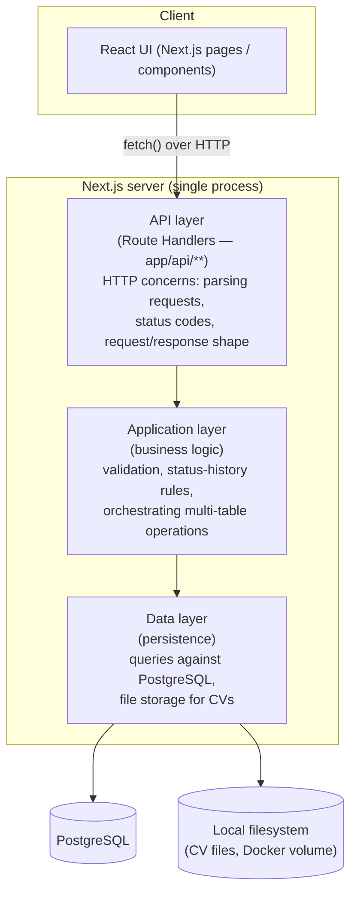

# Architecture

## How Next.js fits together

Yes — Next.js can serve both the UI and the backend from a single project.
Since this is your first project on it, here's the shape in plain terms:

- **Pages/UI** live under `app/` as React components (Server and Client
  Components). This is what renders in the browser.
- **HTTP API endpoints** live alongside them as *Route Handlers* — files
  named `route.ts` under `app/api/**`. Each one exports functions named
  after HTTP verbs (`GET`, `POST`, `PATCH`, `DELETE`) and Next.js wires them
  up to a URL automatically based on the folder path (e.g.
  `app/api/organizations/route.ts` → `GET/POST /api/organizations`).
- These route handlers are plain HTTP endpoints — the same request/response
  model as any other backend framework. The React UI calls them with
  `fetch`, the same way it would call any REST API.

So: **one project, one dev server, one Docker image**, but two things
running inside it — pages and an HTTP API — because Next.js is designed to
be both a frontend and a backend framework at once.

This document intentionally stops at that level of detail. Exact folder
conventions, which parts are Server Components vs. Client Components, the
ORM/query layer, and validation library are **implementation-phase
decisions** — not fixed here, since the goal right now is agreeing on the
domain and the API surface, not on Next.js internals.

## Logical layers

Regardless of exact file layout, the server side of the app is expected to
separate into three logical layers. This is a conceptual model to design
against — not a mandate on folder names.



- **API layer** — thin. Receives HTTP requests, validates shape, calls into
  the application layer, maps results to HTTP responses. No business rules
  live here.
- **Application layer** — where domain rules from
  [01-domain-model.md](./01-domain-model.md) live: e.g. "creating a job
  application also creates its first status-history row", "a CV can't be
  deleted while referenced". This layer is framework-agnostic in spirit,
  even if it happens to be TypeScript functions called directly by route
  handlers (no network hop needed — it's the same process).
- **Data layer** — the only layer that talks to PostgreSQL or the
  filesystem. Everything above it works with domain objects, not SQL rows
  or file paths directly.

This layering exists so that business rules (layer 2) aren't duplicated
across every route handler, and so persistence details (layer 3) can change
later (e.g. swapping raw SQL for an ORM) without touching the other two.

## Authentication flow

Signup and sign-in are Server Actions (`src/features/auth/*/actions/`), not
Route Handlers — the app calls into the server the same way for auth as for
everything else, via `<form action={...}>` / `useActionState`, not `fetch()`
against a JSON API. Every other Server Action requires the caller to be
authenticated. Concretely:

1. **Signup** hashes the given password and creates a `User` row, then signs
   the new user in immediately (see below) — no separate email verification
   step in this phase.
2. **Sign-in** verifies the given email/password against `password_hash`,
   then issues a signed JWT (the user's `id` as its subject, plus an
   expiry) and sets it as the `session` cookie: HTTP-only, `SameSite=Lax`.
   `SameSite=Lax` is sufficient CSRF protection here since the app is
   single-origin (no third-party site ever needs to submit requests to it).
3. **Every other Server Action** calls `verifySession()`
   (`src/lib/session.ts`) before doing anything else — it reads the
   `session` cookie and verifies the JWT's signature and expiry, silently
   reissuing it if it's only expired (see below). `getUserId(session)` then
   pulls the `sub` claim out of an already-verified session; it never
   re-verifies anything itself, and the user id is never trusted from
   client input (see [01-domain-model.md](./01-domain-model.md) business
   rules). Not every Server Action needs a user id — `verifySession()` is
   only called where authentication is actually required, and
   `getUserId()` is a separate step so an action can check "is someone
   signed in" without needing their id at all.
4. **Logout** simply clears the cookie client-side. Because the JWT is
   stateless (no sessions table), there's no server-side revocation before
   its natural expiry.

### Token refresh, without a refresh token

There is deliberately **no refresh token** — one more moving part (a second
token, its own storage/rotation) that a personal, single-user app doesn't
need. Instead, an expired JWT can still be silently renewed, because JWT
verification checks the signature *before* it checks expiry: if a token
fails verification for being expired specifically — as opposed to a bad
signature, wrong algorithm, or malformed token — that already proves it was
genuinely issued by this app for this user; only its age is a problem.

This happens entirely **inline inside `verifySession()`**, with no separate
route or redirect — a Server Action can read and write cookies in the same
request it's already handling, so there's no round trip to make:

- **Valid session** — return it as-is.
- **Expired, but the signature checks out** — look the user up by the
  token's `sub`; if they still exist, issue a brand new JWT, set it as the
  `session` cookie, and return the (still-valid) claims to the caller, who
  continues as if nothing happened. No password, no refresh token — the
  expired-but-genuine JWT is itself the proof of identity.
- **Genuinely invalid** (bad signature, wrong algorithm, tampered), or the
  user behind an expired token no longer exists — nothing can be salvaged,
  so this redirects to `/sign-in`. This is the one case that's still a real
  navigation: there's no identity to hand back to the caller.

`getUserId(session)` throws if a *valid* session has no `sub` — a malformed
or foreign token that verified against our secret but was never issued
correctly. That can't be fixed by refreshing (it isn't expired) or by
retrying (the same broken cookie comes back every time), so it's treated as
a genuine bug signal rather than a normal, recoverable auth failure.

## File storage for documents

Uploaded CV and cover letter files are **not** stored in PostgreSQL as
blobs. They're written to a local directory (mounted as a Docker volume —
see [05-deployment.md](./05-deployment.md)), and the `document` table
stores only the `file_path` pointing at them. This keeps the database small
and lets files be inspected/backed up directly on disk.

## ORM and migrations: Prisma

The **data layer** is implemented with Prisma (`@prisma/orm-postgres`, v8
release-candidate). This version is a significant departure from classic
Prisma — no `schema.prisma` file, and no `prisma migrate dev`/`deploy`.
Instead:

- The schema is authored as TypeScript in `database/contract.ts` (a code
  DSL — models, fields, relations — rather than the old `.prisma` syntax).
- `npm run contract:generate` (`prisma contract emit`) compiles that source
  into `database/contract.json` and `database/contract.d.ts` — generated
  artifacts (never hand-edited) that `database/db.ts` loads to build the
  typed client. Run it after every change to `contract.ts`.
- Migrations are a **static, hand-planned graph** of on-disk packages under
  `database/migrations/`, not an auto-diffed history. `prisma migration
  plan` compares the current contract against the graph and writes a new
  migration package (offline — no DB required); `prisma db migrate` applies
  every pending on-disk migration forward. Notably, applying **never
  invents a rollback edge** — a "down" migration only exists if you
  explicitly plan one first.

### npm scripts

- **`migrations:up`** (`prisma db migrate`) — applies every pending
  on-disk migration to the database, advancing it forward. This is the
  normal "run my migrations" command.
- **`migrations:down`** (`prisma migration plan --name rollback --to`) —
  *plans* (writes to disk, does not apply) a new migration that reverses
  back to an earlier state. It needs the target migration to undo, named
  explicitly: `npm run migrations:down -- <migration-dir>^` (the `^` means
  "the state before that migration"; find directory names with `prisma
  migration list`). Review the generated package, then run `npm run
  migrations:up` to actually apply it — Prisma 8 deliberately keeps
  planning and applying separate here, so a rollback is never applied
  silently.

### Creating a migration

Concretely, adding or changing a table means:

1. **Edit the schema.** Change fields in the relevant `database/models/*.ts`
   file (add a field, add a model, wire a new relation in the matching
   `*.relations.ts` file, register a brand-new model in `database/contract.ts`).
2. **Regenerate the compiled contract:** `npm run contract:generate`. Do
   this after every edit, before planning — the planner diffs against this
   generated output, not your source files directly.
3. **Plan the migration:** `npx prisma migration plan --name <short-slug>`
   (e.g. `--name add-interview-notes`). This is offline — no database
   connection needed — and writes a new, timestamped package under
   `database/migrations/app/<timestamp>_<slug>/` containing the SQL to get
   from the previous schema state to the new one. For the very first
   migration in a project, this is a "baseline" plan that creates
   everything.
4. **Review the generated package** before applying — it's plain SQL
   (`CREATE TABLE`, `ALTER TABLE ... ADD COLUMN`, etc.) you can read
   directly. This step matters: the planner works from the on-disk
   migration graph plus a local ref file, not by inspecting the live
   database, so confirming it diffs from where you expect (not a
   surprise full rebuild) is worth the extra look.
5. **Apply it:** `npm run migrations:up`. This runs against whatever
   `DATABASE_URL` you have configured (see [05-deployment.md](./05-deployment.md)).
6. **Commit the new `database/migrations/app/<dir>` folder.** Migrations
   are version-controlled, plan-then-apply artifacts, not generated/ignored
   output — everyone applying the schema needs the same package.

### Creating an empty migration (a custom data fix)

The steps above cover a *schema* change, which `migration plan` can diff
automatically. Sometimes there's nothing for the planner to detect — a
one-off data fix, a manual backfill unrelated to any column being added
right now — and for that you author a migration directly:

```bash
npx prisma migration new --name <snake_slug>
```

This renders an **empty** package at `database/migrations/app/<timestamp>_<slug>/`
— same shape as a planned one, just with an empty `operations` list instead
of a diffed one. You then:

1. Edit its `migration.ts`, adding your own step(s) to the `operations`
   getter — typically a `this.dataTransform(endContract, '<name>', { check, run })`
   call: `check` is a query returning a row if work remains, `run` is the
   actual mutation, both built as query-builder closures against the
   migration's own `endContract` (Prisma's docs cover the exact query
   syntax — this project doesn't have one of these yet to point at as a
   worked example).
2. **Self-emit** to turn your edits into the package's real artifacts:
   `node database/migrations/app/<dir>/migration.ts`. This regenerates
   `ops.json`/`migration.json` from the TS — it's the only supported way
   to update a migration package after hand-editing it.
3. Apply it the same way as any other migration: `npm run migrations:up`.

This is also how a migration package for **any** hand-authored operation
gets created — not just data fixes — whenever there's no schema diff for
`migration plan` to pick up.

## Seeding: reference data vs. sample data

Prisma 8 has no first-class seeding concept — confirmed against the
official docs, which name a hand-written TypeScript script invoked via an
npm script as the intended workaround. This project uses that workaround
for two *deliberately separate* purposes, since they have different
audiences and different rules about when they run:

- **`database/reference-data/`** — data every instance of this app needs to
  function, not optional. Right now that's just `countries` (you can't
  create an `Organization` or `JobApplication` without a `Country` to
  reference — see [02-database-schema.md](./02-database-schema.md#seed-data--country)).
  Run via `npm run db:seed`, which is itself part of `npm run db:setup`
  (`migrations:up` then `db:seed`) — setting up a fresh database is meant
  to be one command, not "migrate, then remember to also seed."
- **`database/sample-data/`** — genuinely optional dev fixtures (currently
  one example `User`), for a frontend developer who wants something to
  render against without hand-creating rows first. Run manually via
  `npm run db:seed:sample`, **never** part of `db:setup` — an empty
  database (beyond reference data) is the correct state for anyone not
  explicitly asking for fixtures.

Both follow the same internal shape: each module exports one named
`seed<Thing>(db)` function; each folder's `index.ts` is the explicit,
hand-written call order (`seedReferenceData` / `seedSampleData`) — not
inferred from filenames, so adding a new module is one import and one call,
no renumbering; a small `<name>.ts` entrypoint at the `database/` root
opens the `db` client and runs the folder's `index.ts`.

**Writing values for `varchar(n)` fields in a seed script:** the generated
contract types every sized-string field with an extra compile-time-only
marker (`string & { readonly __varcharLength: n }`), so a plain string
literal isn't directly assignable to a `.create()`/`.upsert()` call — and
the real marker type lives in an internal package
(`@prisma/orm-target-postgres`) this project's own conventions (and the
framework's docs) say never to import from. `database/field-values.ts`
exports a small `sized<N>(value)` helper (and a `uuid(value)` counterpart
for uuidString() fields) with a **structurally identical** local type —
TypeScript only checks shape, so this satisfies the real one without
importing anything internal. Any future write path (signup creating a
`User`, creating an `Organization`, etc.) will hit the same thing and can
reuse these helpers.

## Open questions for the implementation phase

These are deliberately **not** decided yet:

- Server Components vs. Client Components split in the UI
- Validation library for request payloads (e.g. Zod)
- Exact `app/` folder structure beyond the `api/` convention described above
- JWT expiry duration and where the signing secret lives (env var at minimum)
- Password hashing library (bcrypt vs. argon2)
