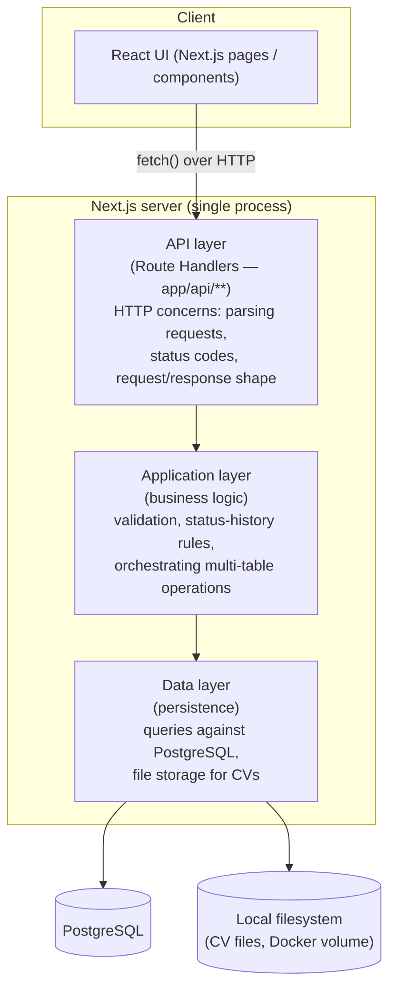

# Architecture

## How Next.js fits together

Yes — Next.js can serve both the UI and the backend from a single project.
Since this is your first project on it, here's the shape in plain terms:

- **Pages/UI** live under `app/` as React components (Server and Client
  Components). This is what renders in the browser.
- **HTTP API endpoints** live alongside them as *Route Handlers* — files
  named `route.ts` under `app/api/**`. Each one exports functions named
  after HTTP verbs (`GET`, `POST`, `PATCH`, `DELETE`) and Next.js wires them
  up to a URL automatically based on the folder path (e.g.
  `app/api/organizations/route.ts` → `GET/POST /api/organizations`).
- These route handlers are plain HTTP endpoints — the same request/response
  model as any other backend framework. The React UI calls them with
  `fetch`, the same way it would call any REST API.

So: **one project, one dev server, one Docker image**, but two things
running inside it — pages and an HTTP API — because Next.js is designed to
be both a frontend and a backend framework at once.

This document intentionally stops at that level of detail. Exact folder
conventions, which parts are Server Components vs. Client Components, the
ORM/query layer, and validation library are **implementation-phase
decisions** — not fixed here, since the goal right now is agreeing on the
domain and the API surface, not on Next.js internals.

## Logical layers

Regardless of exact file layout, the server side of the app is expected to
separate into three logical layers. This is a conceptual model to design
against — not a mandate on folder names.

- **API layer** — thin. Receives HTTP requests, validates shape, calls into
  the application layer, maps results to HTTP responses. No business rules
  live here.
- **Application layer** — where domain rules from
  [01-domain-model.md](./01-domain-model.md) live: e.g. "creating a job
  application also creates its first status-history row", "a CV can't be
  deleted while referenced". This layer is framework-agnostic in spirit,
  even if it happens to be TypeScript functions called directly by route
  handlers (no network hop needed — it's the same process).
- **Data layer** — the only layer that talks to PostgreSQL or the
  filesystem. Everything above it works with domain objects, not SQL rows
  or file paths directly.

This layering exists so that business rules (layer 2) aren't duplicated
across every route handler, and so persistence details (layer 3) can change
later (e.g. swapping raw SQL for an ORM) without touching the other two.

## Authentication flow

Signup and login are their own endpoints (`/api/auth/signup`,
`/api/auth/login` — see [04-api-design.md](./04-api-design.md#authentication));
every other endpoint requires the caller to be authenticated. Concretely:

1. **Signup** hashes the given password and creates a `User` row, then logs
   the new user in immediately (see below) — no separate email verification
   step in this phase.
2. **Login** verifies the given email/password against `password_hash`,
   then issues a signed JWT (the user's `id` as its subject, plus an
   expiry) and sets it as an HTTP-only, `SameSite=Lax` cookie. `SameSite=Lax`
   is sufficient CSRF protection here since the app is single-origin (no
   third-party site ever needs to submit requests to it).
3. **Every other route handler** verifies that JWT before doing anything
   else — checking its signature and expiry, then reading the user id from
   it. This check sits at the front of the **API layer** (e.g. a shared
   helper each route handler calls first, or Next.js middleware — an
   implementation-phase choice), so the application and data layers below
   it never see a request without a trusted `user_id` already resolved. A
   missing/invalid/expired token short-circuits to `401` before reaching
   the application layer.
4. **Logout** simply clears the cookie client-side. Because the JWT is
   stateless (no sessions table), there's no server-side revocation before
   its natural expiry — an accepted tradeoff of this approach, worth
   revisiting if it ever matters (e.g. a short-lived JWT plus a longer-lived
   refresh token, or moving to DB-backed sessions).

## File storage for documents

Uploaded CV and cover letter files are **not** stored in PostgreSQL as
blobs. They're written to a local directory (mounted as a Docker volume —
see [05-deployment.md](./05-deployment.md)), and the `documents` table
stores only the `file_path` pointing at them. This keeps the database small
and lets files be inspected/backed up directly on disk.

## ORM and migrations: Prisma

The **data layer** is implemented with Prisma (`@prisma/orm-postgres`, v8
release-candidate). This version is a significant departure from classic
Prisma — no `schema.prisma` file, and no `prisma migrate dev`/`deploy`.
Instead:

- The schema is authored as TypeScript in `database/contract.ts` (a code
  DSL — models, fields, relations — rather than the old `.prisma` syntax).
- `npm run contract:generate` (`prisma contract emit`) compiles that source
  into `database/contract.json` and `database/contract.d.ts` — generated
  artifacts (never hand-edited) that `database/db.ts` loads to build the
  typed client. Run it after every change to `contract.ts`.
- Migrations are a **static, hand-planned graph** of on-disk packages under
  `database/migrations/`, not an auto-diffed history. `prisma migration
  plan` compares the current contract against the graph and writes a new
  migration package (offline — no DB required); `prisma db migrate` applies
  every pending on-disk migration forward. Notably, applying **never
  invents a rollback edge** — a "down" migration only exists if you
  explicitly plan one first.

### npm scripts

- **`migrations:up`** (`prisma db migrate`) — applies every pending
  on-disk migration to the database, advancing it forward. This is the
  normal "run my migrations" command.
- **`migrations:down`** (`prisma migration plan --name rollback --to`) —
  *plans* (writes to disk, does not apply) a new migration that reverses
  back to an earlier state. It needs the target migration to undo, named
  explicitly: `npm run migrations:down -- <migration-dir>^` (the `^` means
  "the state before that migration"; find directory names with `prisma
  migration list`). Review the generated package, then run `npm run
  migrations:up` to actually apply it — Prisma 8 deliberately keeps
  planning and applying separate here, so a rollback is never applied
  silently.

## Open questions for the implementation phase

These are deliberately **not** decided yet:

- Server Components vs. Client Components split in the UI
- Validation library for request payloads (e.g. Zod)
- Exact `app/` folder structure beyond the `api/` convention described above
- JWT expiry duration and where the signing secret lives (env var at minimum)
- Password hashing library (bcrypt vs. argon2)
