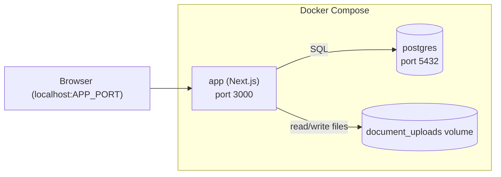

# Deployment

This describes the deployment **topology** — services, volumes, ports —
and what's explicitly out of scope for now. For instructions on actually
running the app (day-to-day dev, or fully containerized), see the main
[`README.md`](../README.md) — that's where developer-facing "how do I run
this" content lives; this doc is for the shape underneath it, and for
production/hosting concerns if this is ever deployed beyond your own
machine (a real server, secrets management, backups, monitoring — none of
that exists yet, see *Explicitly out of scope*).

Currently: local-only, Docker-based, personal deployment. No cloud
provider, no CI/CD. The app has real signup/sign-in (see
[04-api-design.md](./04-api-design.md#authentication)), but since it's
served over plain `http://localhost`, the session cookie is not marked
`Secure` (that flag requires HTTPS) — this is exactly the kind of thing
that would need revisiting if this were ever hosted somewhere reachable
beyond your own machine.

## Shape

`docker-compose` with two services:

- **`app`** — the Next.js application (UI + API routes in one container),
  built from a `Dockerfile` in the repo root. Always listens on port `3000`
  *inside* the container (matching the Dockerfile); the host-facing port is
  `APP_PORT` (`.env`, default `3001`) — deliberately different from `3000`
  so the containerized app and a locally-running `npm run dev` (fixed at
  `3000`, see [`README.md`](../README.md)) can run side by side without a
  port clash.
- **`db`** — official `postgres` image, with a bind mount
  (`.container-data/postgres-data`, gitignored) for data persistence
  across container restarts.
- **`document_uploads`** — a separate named volume mounted into `app`,
  holding the uploaded CV/cover letter files referenced by
  `documents.file_path`.

The real `docker-compose.yml` at the repo root is authoritative — see it
directly rather than an illustrative copy here. It doesn't yet have
`document_uploads`/a `JWT_SECRET` since uploads and auth aren't implemented.

## Explicitly out of scope

- Remote hosting, domains, TLS.
- Backups/disaster recovery beyond "the Docker volumes are on your disk".
- Secrets management beyond a local `.env` file, environment-specific
  configs (staging/prod) — there is only one environment: your machine.
  (Real multi-user *accounts* are in scope via signup/sign-in — see
  [04-api-design.md](./04-api-design.md#authentication) — it's the
  deployment/infrastructure that stays single-environment.)
